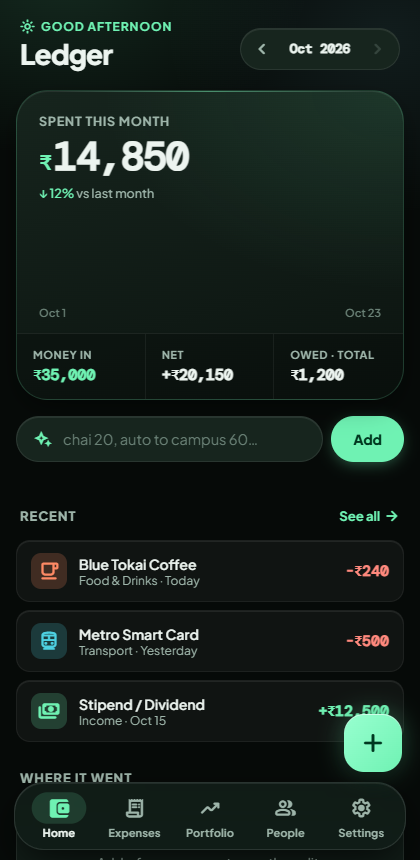

<div align="center">

# 💳 Ledger — Personal Expense & Investment PWA

<p><strong>A mobile-first, zero-framework progressive web application for real-time personal finance tracking, portfolio monitoring, and Gemini-powered expense parsing.</strong></p>

[](https://personal-expense-dash.vercel.app)
[](https://vercel.com)
[](https://personal-expense-dash.vercel.app)
[](https://supabase.com)
[](https://ai.google.dev)
[](LICENSE)

<br />

<a href="https://personal-expense-dash.vercel.app">
  
</a>

<br /><br />

[**Launch Live App ↗**](https://personal-expense-dash.vercel.app)

</div>

---

## 🚀 Overview

**Ledger** is a high-performance, single-file Progressive Web App (PWA) designed to eliminate friction in daily financial accounting. Built without heavy JS frameworks, it opens instantly, runs offline via service workers, and syncs seamlessly with **Supabase (PostgreSQL)**.

Natural language spending inputs (e.g., *"chai 20, auto to campus 60"*) are parsed and categorized in real time using the **Google Gemini API**, while a reactive dark liquid-glass UI makes monitoring your net worth, investments, and group debts effortless.

---

## ✨ Key Features

- **⚡ Instant Single-File PWA:** Fully contained within a standalone `index.html` file with service worker caching (`sw.js`) and PWA installation support for iOS and Android home screens.
- **🧠 Natural-Language Quick Add (Gemini AI):** Type or dictate messy daily expenses; Gemini's generative language model parses amount, category, merchant, and notes automatically.
- **📩 SMS Gap Detection:** Reconciles offline or external transactions by cross-referencing recent payment alerts with logged expenses to ensure zero missing records.
- **📈 Portfolio & Asset Holdings:** Real-time visibility into equity, mutual funds, gold, and debt holdings with automated P&L calculations and asset allocation bars.
- **🤝 Debt & Reimbursement Tracker:** Keeps tabs on split expenses, roommates, and household bills with one-click settlement matching.
- **🎨 Liquid-Glass Design System:** Responsive dark theme based on Material 3 tokens, featuring smooth swipe actions, undo snackbars, and notch/safe-area compatibility.

---

## 🛠️ Tech Stack

| Layer | Technology |
|---|---|
| **Frontend & UI** | Pure Vanilla HTML5 / CSS3 / ES6+ (Single-file architecture) |
| **PWA & Offline** | Web App Manifest (`manifest.json`) · Service Worker (`sw.js`) Cache API |
| **Database & Auth** | [Supabase](https://supabase.com) (PostgreSQL with Row-Level Security) |
| **Natural Language AI**| [Google Gemini API](https://ai.google.dev) (`generativelanguage.googleapis.com`) |
| **Typography & Icons** | Plus Jakarta Sans · DM Mono · Material Symbols Rounded |
| **Hosting & CI/CD** | [Vercel](https://vercel.com) (Continuous zero-config deployment) |

---

## 🗄️ Database Schema (Supabase)

To replicate the backend tables in your own Supabase project, execute the following in your Supabase SQL Editor:

```sql
-- Enable UUID generation
CREATE EXTENSION IF NOT EXISTS "uuid-ossp";

-- 1. Transactions
CREATE TABLE transactions (
    id UUID PRIMARY KEY DEFAULT uuid_generate_v4(),
    user_id UUID REFERENCES auth.users(id) ON DELETE CASCADE,
    amount NUMERIC(12, 2) NOT NULL,
    category TEXT NOT NULL,
    merchant TEXT,
    note TEXT,
    date DATE DEFAULT CURRENT_DATE,
    created_at TIMESTAMPTZ DEFAULT NOW()
);

-- 2. Investments & Holdings
CREATE TABLE investments (
    id UUID PRIMARY KEY DEFAULT uuid_generate_v4(),
    user_id UUID REFERENCES auth.users(id) ON DELETE CASCADE,
    asset_name TEXT NOT NULL,
    asset_type TEXT NOT NULL, -- 'Equity', 'Mutual Fund', 'Gold', etc.
    invested_amount NUMERIC(12, 2) NOT NULL,
    current_value NUMERIC(12, 2) NOT NULL,
    is_estimate BOOLEAN DEFAULT FALSE,
    updated_at TIMESTAMPTZ DEFAULT NOW()
);

-- 3. Debts & Reimbursements
CREATE TABLE people (
    id UUID PRIMARY KEY DEFAULT uuid_generate_v4(),
    user_id UUID REFERENCES auth.users(id) ON DELETE CASCADE,
    name TEXT NOT NULL,
    phone TEXT,
    balance NUMERIC(12, 2) DEFAULT 0.00
);

CREATE TABLE debts (
    id UUID PRIMARY KEY DEFAULT uuid_generate_v4(),
    user_id UUID REFERENCES auth.users(id) ON DELETE CASCADE,
    person_id UUID REFERENCES people(id) ON DELETE CASCADE,
    amount NUMERIC(12, 2) NOT NULL,
    note TEXT,
    is_settled BOOLEAN DEFAULT FALSE,
    created_at TIMESTAMPTZ DEFAULT NOW()
);

-- Enable Row-Level Security
ALTER TABLE transactions ENABLE ROW LEVEL SECURITY;
ALTER TABLE investments ENABLE ROW LEVEL SECURITY;
ALTER TABLE people ENABLE ROW LEVEL SECURITY;
ALTER TABLE debts ENABLE ROW LEVEL SECURITY;
```

---

## 🚀 Getting Started

### Local Development

1. **Clone the repository:**
   ```bash
   git clone https://github.com/Kahaan83/personal-expense-dash.git
   cd personal-expense-dash
   ```

2. **Serve locally:**
   ```bash
   # Using Python:
   python -m http.server 8080

   # Or using npx:
   npx serve .
   ```

3. Open **`http://localhost:8080`** in a modern browser.

### Cloud Configuration

1. In the app settings drawer, configure your:
   - **Supabase URL & Anon Key**
   - **Gemini API Key** *(stored locally in `localStorage`, never sent to any server)*.
2. Ensure Row Level Security (RLS) is enabled on your Supabase tables to protect personal financial data.

---

## 🔒 Security Best Practices

- **Zero-Backend Storage of AI Keys:** Your Gemini API Key resides strictly inside your browser's encrypted `localStorage` sandbox.
- **Row-Level Security (RLS):** All database operations query Supabase directly through authenticated RLS policies, ensuring each user's records are strictly isolated.
- **Data Privacy:** Financial statements and personal transactions are never committed to version control (see `.gitignore`).

---

## 👤 Author

**Kahaan Shah**
- Portfolio: [kahaanshah.in](https://kahaanshah.in)
- GitHub: [@Kahaan83](https://github.com/Kahaan83)
- LinkedIn: [linkedin.com/in/kahaan-shah-842095334](https://www.linkedin.com/in/kahaan-shah-842095334/)

---

## 📄 License

This project is licensed under the MIT License — see the [LICENSE](LICENSE) file for details.
